# Awesome-AR-Remote-Assistance 🥽 📡

  

  
  
  
  
  
  

---

## 🌟 Top AR Remote Assistance Ecosystem

**Curated List of Enterprise SaaS Platforms & Open-Source Augmented Reality Guidance Frameworks**  
*Comprehensive directory covering Real-Time Video Streaming, AR Spatial Annotations, Expert-to-Field Collaboration, WebRTC Low-Latency Telepresence, Multi-User Sessions, Digital Work Instructions, Smart Glasses, and Self-Hosted XR Support.*

**Last updated: October 2026** 📅

---

### 📌 Overview & SEO Summary

Welcome to the definitive curated directory of **Augmented Reality (AR) remote assistance platforms**, **open-source remote visual guidance software**, and **mixed reality (MR / XR) collaboration tools**. Whether evaluating enterprise commercial solutions (such as *Salesforce Visual Remote Assistant*, *Zoho Lens*, *TeamViewer Frontline*, or *PTC Vuforia Chalk*) or deploying open-source, privacy-respecting alternatives (such as *TeleopXR*, *ARENA*, *SurfaceCast*, and *Ghost Hands*), this guide indexes solutions by market valuation, transparent starting prices, free tier limits, WebRTC video engines, and GitHub popularity.

#### 🔍 Why AR Remote Assistance?
Augmented Reality remote assistance transforms industrial maintenance, frontline troubleshooting, field service management (FSM), and technical training. Technicians stream live first-person video from mobile devices or smart glasses (HoloLens 2, Magic Leap 2, Apple Vision Pro, Meta Quest 3, Vuzix, RealWear) to remote experts, who draw 3D spatial anchors, highlight components, and overlay visual instructions in real time.

**Key Industry & Market Context:**
- **Market Size & Structure**: The global AR Remote Assistance software and solutions market reached approximately **$2.3 billion in 2024** and is projected to expand to **$13.4 billion – $14.3 billion by 2030–2033** at a robust CAGR of **20% to 35%**. The sector is currently **moderately concentrated**, with top enterprise cloud and industrial vendors capturing roughly 50% market share alongside innovative specialized startups.
- **Enterprise Migrations**: Microsoft has officially sunset sales and renewals for **Dynamics 365 Remote Assist**, with complete end-of-support scheduled for **December 31, 2026**. Similarly, PTC retired **Vuforia Chalk** on October 31, 2025 (transitioning accounts to ServiceMax Zinc). Enterprises are migrating to CRM-native tools (Salesforce VRA, Zoho Lens) or dedicated industrial connected-worker suites (TeamViewer Frontline, Librestream Onsight).
- **Open-Source Emergence**: Open-source teleoperation and WebXR frameworks like **TeleopXR** (robotics telepresence & digital twins) and **ARENA** (multi-user spatial WebXR) provide foundational WebRTC infrastructure for custom, self-hosted field guidance.

---

## 📑 Table of Contents
- [🏢 SaaS & Commercial Platforms](#-saas--commercial-platforms)
- [🔓 Open-Source GitHub Projects](#-open-source-github-projects)
- [🛠️ How to Contribute](#%EF%B8%8F-how-to-contribute)
- [📊 Star History](#-star-history)
- [🤝 Support & Sponsorship](#-support--sponsorship)
- [⚠️ Disclaimer](#%EF%B8%8F-disclaimer)

---

## 🏢 SaaS & Commercial Platforms

> **Market Analysis & Fragmentation**: The global AR remote assistance market is valued at approximately **$2.3B (2024)** and projected to reach **$13.4B–$14.3B by 2030–2033** (~25–35% CAGR). The market structure is **moderately concentrated** (the top 5 vendors hold ~48–55% revenue share, while specialized vertical providers and CRM/FSM software giants coexist without a single "winner-take-all" monopoly).

*Sorted by Company Valuation / Market Cap (Descending)* 🏢

| SaaS / Commercial Platform | Company / Owner | Valuation / Market Cap | Standard Edition Starting Price | Free Tier / Free Trial Limits | Description |
| :--- | :--- | :--- | :--- | :--- | :--- |
| **[Microsoft Dynamics 365 Remote Assist](https://dynamics.microsoft.com/en-us/mixed-reality/remote-assist/)** 🔷 | Microsoft | ~$3.90 Trillion | **$65/user/month** (historic standalone list price; $20/user/month attach) | **No free tier** (30-day trial previously; retired from sale Nov 2025; end-of-support Dec 31, 2026) | **Mixed reality remote assistance** — HoloLens 2 and mobile video collaboration with 3D spatial annotations. Sunsetting Dec 31, 2026. |
| **[Salesforce Visual Remote Assistant](https://www.salesforce.com/products/field-service/features/visual-remote-assistant/)** ☁️ | Salesforce | ~$250 Billion | **$50/user/month** (billed annually as Service Cloud / Field Service add-on) | **30-day free trial** (Salesforce Field Service trial; included in select Enterprise/Agentforce bundles) | **CRM-native AR visual assistance** — Connect field technicians with remote experts via live video, 2-way AR drawing, and automated CRM work orders. |
| **[PTC Vuforia Chalk](https://www.ptc.com/en/products/vuforia/vuforia-chalk)** 🎯 | PTC | ~$15 Billion | **$100/user/month** (historic enterprise package baseline) | **No free tier** (30-day trial previously; retired Oct 31, 2025; customers migrated to ServiceMax Zinc) | **Pioneering AR remote assistance** — Shared video feed with real-time digital chalk annotations anchored to physical surfaces. |
| **[Zoho Lens](https://www.zoho.com/lens/)** 🔴 | Zoho Corporation | ~$12.5 Billion | **$17/technician/month** (billed annually, or $20 billed monthly) | **Free forever plan** (1 user, unlimited remote sessions, 7-day recording retention) + **15-day free trial** of Professional | **Cost-effective AR remote guidance** — Live camera stream, real-time 3D spatial annotations, freeze frame, VOIP, text chat, and cloud recording. |
| **[TeamViewer Frontline (xAssist)](https://www.teamviewer.com/en/frontline/)** 🟢 | TeamViewer SE | ~$5 Billion | **$74/user/month** (estimated baseline; quote-based enterprise licensing) | **14-day free trial** (access to xAssist remote support workflows on request) | **Industrial connected worker suite** — AR remote assistance and digital work instructions tailored for wearable smart glasses (RealWear, Vuzix). |
| **[CareAR](https://www.carear.com/)** 🟥 | Xerox Corporation | ~$2 Billion | **$50/user/month** (enterprise quote-based starting baseline) | **14-day free trial / guided sandbox demo** upon sales request | **Service Experience Management (SXM)** — AI and AR visual assistance platform with step-by-step guidance, digital workflows, and ServiceNow/Salesforce integration. |
| **[SightCall](https://sightcall.com/)** 🟣 | SightCall Inc. | ~$300 Million | **$45/user/month** (enterprise subscription baseline starting quote) | **14-day customized pilot / interactive demo** (no public self-serve free tier) | **Enterprise visual assistance & AI** — WebRTC-powered live video with AR drawing, optical character recognition (OCR), measurement tools, and CRM/FSM connectors. |
| **[Librestream Onsight](https://www.librestream.com/)** 🟠 | Librestream Technologies | ~$75 Million | **$100/user/month** (enterprise annual contract starting baseline) | **14-day enterprise pilot trial / interactive demo** on request | **Industrial augmented worker platform** — Onsight Connect enables secure AR video collaboration, IoT thermal imaging integration, and low-bandwidth remote inspection. |
| **[Help Lightning](https://helplightning.com/)** 🔵 | Help Lightning Inc. | ~$37 Million | **$30/user/month** (enterprise baseline license; annual agreements starting ~$75K) | **14-day trial pilot / interactive guided demo** on request | **Patented virtual interactive presence** — Merges two real-time video streams allowing experts to inject their actual hands and tools virtually into field view. |
| **[Scope AR (WorkLink)](https://www.scopear.com/)** 🟡 | Flatirons Solutions (TELEO Capital) | ~$34 Million | **$75/user/month** (enterprise WorkLink baseline quote) | **14-day guided proof-of-concept / sandbox trial** on request | **Unified AR platform** — Integrates real-time remote video assistance with 3D CAD-based interactive work instructions and visual assembly verification. |
| **[Blitzz](https://www.blitzz.co/)** 🟤 | Blitzz Inc. | ~$15 Million | **$19/agent/month** (Co-Browse) / **$175/month** (Concierge, includes 5 users = $35/user) | **14-day full-featured free trial** (no app download required for end-users) | **App-free remote video inspection** — Universal browser-based AR video assistance, markup tools, optical OCR, and field service management tools. |

---

## 🔓 Open-Source GitHub Projects

*Sorted by GitHub_Stars_Count (Descending)* 🌟

- **[TeleopXR](https://github.com/qrafty-ai/teleop_xr)**   
  **Open-source XR teleoperation and remote expert control framework**. Transforms VR/AR headsets into precise controllers with **ultra-low-latency WebRTC video streaming**, VR/Passthrough modes for situational awareness, real-time 3D digital twins, and Whole-Body Inverse Kinematics (IK). Designed for expert control of field equipment and collaborative robotics. 🤖

- **[ARENA (ARENA-web-core)](https://github.com/arenaxr/arena-web-core)**   
  **Real-time mixed reality multi-user collaboration platform**, open-source. Built with **A-Frame and Three.js**, supporting WebXR-capable browsers across Microsoft HoloLens, Meta Quest, Apple Vision Pro, and mobile ARCore devices. Includes pub/sub spatial messaging, WASM modules, and 3D spatial video conferencing. 🌐

- **[Remote Assistant (stonerey)](https://github.com/stonerey/RemoteAssistant)**   
  **AR remote assistance application for Microsoft HoloLens 2 and mobile devices**, open-source. Implemented in **Unity and the Mixed Reality Toolkit (MRTK)**, enabling bi-directional audio/video communication and real-time 3D spatial annotation projection into the technician's physical workspace. 🥽

- **[RemoteAssistantAR (icywind)](https://github.com/icywind/RemoteAssistantAR)**   
  **Real-time remote chat and field assistant app with AR annotations**, open-source. Unity-based multi-platform system delivering synchronized video streaming, 3D pointer placement, and real-time remote annotation overlay on live equipment views. 💬

- **[AR-Remote-Support (AgoraIO-Community)](https://github.com/AgoraIO-Community/AR-Remote-Support)**   
  **Open-source proof-of-concept remote support app (similar to Vuforia Chalk)**. Built using **Apple ARKit and Agora.io Video SDK**, enabling cross-device video calling where experts draw 3D arrows and lines anchored directly to the user's real-world environment. 📱

- **[RemoteAssistanceAR (limvi-licef)](https://github.com/limvi-licef/RemoteAssistanceAR)**   
  **Augmented reality remote assistance client-server suite**, open-source. Written in **C# / Unity**, providing real-time camera streaming from AR glasses and tablets with interactive 3D annotations for maintenance assistance. 🔧

- **[SurfaceCast](https://github.com/floe/surfacecast)**   
  **Collaborative mixed-presence interaction framework**, open-source. Utilizes **WebRTC (H.264/VP8)** and **GStreamer media pipelines** with WebXR clients tested on Meta Quest and HoloLens 2. Supports multi-view interactive tabletops, projector feeds, and spatial annotations. 🖥️

- **[RemotePairEyes](https://github.com/wolverin0/remote-pair-eyes)**   
  **Real-time remote assistance platform utilizing smart glasses**, open-source. Enables hands-free first-person perspective video transmission from wearable devices to remote experts with live audio and interactive visual cues. 👓

- **[RemoteAssistant (dalkofjac)](https://github.com/dalkofjac/RemoteAssistant)**   
  **WebRTC remote assistance for AR smart glasses**, open-source. Connects **Iristick AR smart glasses (Android)** with an Angular web client using peer-to-peer WebRTC video streaming and remote telepresence controls. 🥽

- **[Remote-Assistance (ShreenathManikandaswamy)](https://github.com/ShreenathManikandaswamy/Remote-Assistance)**   
  **Cross-platform AR remote assistance application**, open-source. Connects users across devices allowing a remote specialist to observe live camera feeds and place persistent AR visual markers in the local space. 📐

- **[ARRA (THING-Lab)](https://github.com/THING-Lab/ARRA)**   
  **Augmented Reality Remote Assistance research framework**, open-source. Combines an **Oculus Rift VR Expert Application** with a **Microsoft HoloLens AR Technician Application**, enabling asymmetric immersive collaboration and 3D spatial guidance. 🧪

- **[Ghost Hands](https://github.com/Codesmashershubh/Ghost-Hands)**   
  **Real-time peer-to-peer AR guidance over WebRTC**, open-source. Employs client-side **MediaPipe hand tracking** to overlay a remote helper's live gestures directly onto a technician's camera stream with zero paid APIs and zero server-side data retention. ✋

- **[PING (DarianPiro)](https://github.com/DarianPiro/PING)**   
  **AR remote support app connecting field technicians with experts**, open-source. Features real-time mobile video streaming, dynamic screen drawings, and synchronized field collaboration. 📡

- **[ARRemote (Hisaack)](https://github.com/Hisaack/ARRemote)**   
  **AR Remote Assistance video platform powered by Agora.io SDK**, open-source. Integrates video calling with ARCore spatial tracking for interactive field support. 📹

- **[VebkoArRemoteAssistance (taherfattahi)](https://github.com/taherfattahi/VebkoArRemoteAssistance)**   
  **Android remote support powered by ARCore and WebRTC**, open-source. Combines Google ARCore tracking, WebRTC 1-to-1 video calls, and a Node.js signaling server for industrial remote troubleshooting. 📲

- **[RemoteAssistance (judykhairalla)](https://github.com/judykhairalla/RemoteAssistance)**   
  **Native Android AR remote assistance application**, open-source. Implements Google ARCore surface detection and Agora real-time audio/video streaming for collaborative visual repair. 🛠️

- **[AR-Bridge (Kartik1630)](https://github.com/Kartik1630/AR-Bridge-Augmented-Reality-Remote-Machine-Repair-System.)**   
  **AR-powered remote machine repair architecture**, open-source. End-to-end framework enabling remote expert guidance via 3D annotations overlaid on live industrial machine video feeds using ARCore and Unity. ⚙️

---

## 🛠️ How to Contribute

Contributions are welcome! Follow these steps to submit new AR remote assistance platforms or open-source remote guidance software:

1. 🍴 **Fork** the repository.
2. 📝 **Add/edit** entries in `README.md` maintaining table/list structure and formatting.
3. 🔗 Include project title, official website/GitHub link, exact star badge, license, and brief description.
4. 🚀 Submit a **Pull Request** with a descriptive summary of your changes.

---

## 📊 Star History

---

## 🤝 Support & Sponsorship

If you find this AR remote assistance repository useful, please consider supporting the project:

- ⭐ **Star** this repository to increase visibility!
- 🔀 **Fork** and share with fellow AR engineers, field service leaders, and open-source advocates.
- ☕ **Sponsor & Buy Me a Coffee**: Support ongoing open-source curation via the [GitHub Sponsor Dashboard](https://github.com/sponsors/ishandutta2007).

---

## ⚠️ Disclaimer

- This is a **community-curated** list — not exhaustive and not an endorsement. ℹ️
- **Microsoft Dynamics 365 Remote Assist and Guides will end support on December 31, 2026** . **PTC has made service termination and strategic adjustments for Vuforia Chalk** . **Plan migrations to professional platforms or CRM/FSM-native integrated vendors**.
- **The industry is shifting from simple video+annotation to visual AI + knowledge accumulation + process automation** — early products emphasized remote experts seeing the site and circling problems; current leaders are integrating **session recording, automatic summaries, AI reports, visual recognition, ticket closure, and knowledge base accumulation** as core features.
- **Always validate video latency, annotation alignment, and multi-user synchronization with a proof-of-concept** before production deployment. 🥽

---

  <b>Made with ❤️ for AR engineers, field service leaders, and open-source remote assistance advocates.</b>

